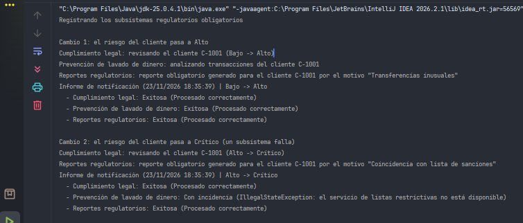
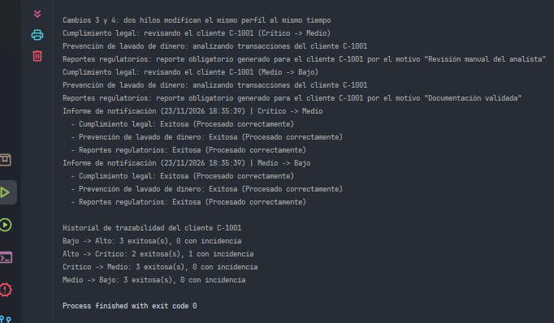

# Ejercicio 10 - Sistema Empresarial de Notificación de Riesgos y Cumplimiento Legal

## Descripción

En una plataforma bancaria internacional, cada cambio en el perfil de riesgo de un cliente debe activar de forma controlada y auditada los subsistemas de cumplimiento legal, prevención de lavado de dinero y generación de reportes regulatorios.

## Objetivos

- Desarrollar un Observer de grado empresarial con trazabilidad de eventos críticos.
- Ejecutar de forma secuencial y controlada a todos los observadores obligatorios.
- Registrar de forma inmutable qué observadores fueron notificados con éxito y cuáles tuvieron incidencias.
- Evitar fallos en cascada y garantizar seguridad en entornos multihilo.

## Implementación del patrón Observer

Se usa la variante robusta con aislamiento de errores y registro de trazabilidad.

- **Sujeto:** `CustomerRiskProfile` guarda el nivel de riesgo y los observadores en un `CopyOnWriteArrayList`, que es seguro para varios hilos y respeta el orden de registro.
- **Ejecución controlada:** `changeRiskLevel` es `synchronized`, por lo que los cambios concurrentes no mezclan sus notificaciones.
- **Aislamiento de errores:** cada observador se ejecuta dentro de su propio `try-catch`. Si uno falla, se registra la incidencia y se continúa con el siguiente.
- **Observador:** `ComplianceObserver` declara `getName()` y `onRiskProfileChanged(RiskProfileChange change)`, que puede lanzar excepciones.
- **Observadores concretos:** `LegalComplianceSystem`, `AntiMoneyLaunderingSystem` (falla cuando el riesgo pasa a crítico) y `RegulatoryReportGenerator`.
- **Trazabilidad:** cada cambio genera un `NotificationReport` inmutable con un `DeliveryRecord` por observador. El historial se expone como copia inmutable.

## Propósito de la clase

- `RiskLevel`: niveles de riesgo.
- `RiskProfileChange`: cambio inmutable que reciben los observadores.
- `DeliveryStatus` y `DeliveryRecord`: resultado de cada notificación.
- `NotificationReport`: informe inmutable de un cambio completo.
- `ComplianceObserver`: interfaz común de los subsistemas regulatorios.
- `CustomerRiskProfile`: sujeto observable seguro y auditable.
- `LegalComplianceSystem`, `AntiMoneyLaunderingSystem` y `RegulatoryReportGenerator`: subsistemas regulatorios.
- `Main`: simula cambios secuenciales, un fallo y cambios concurrentes, y muestra el historial.

## Concepto clave

Ningún fallo individual puede detener el proceso regulatorio: cada observador está aislado y todo queda registrado en informes inmutables, lo que permite auditar qué pasó con cada notificación.

## Resultado

## Conclusión

Combinar Observer con aislamiento de errores, sincronización y registros inmutables produce un diseño apto para entornos regulados. El sistema es resistente a fallos, seguro en multihilo y totalmente trazable.
